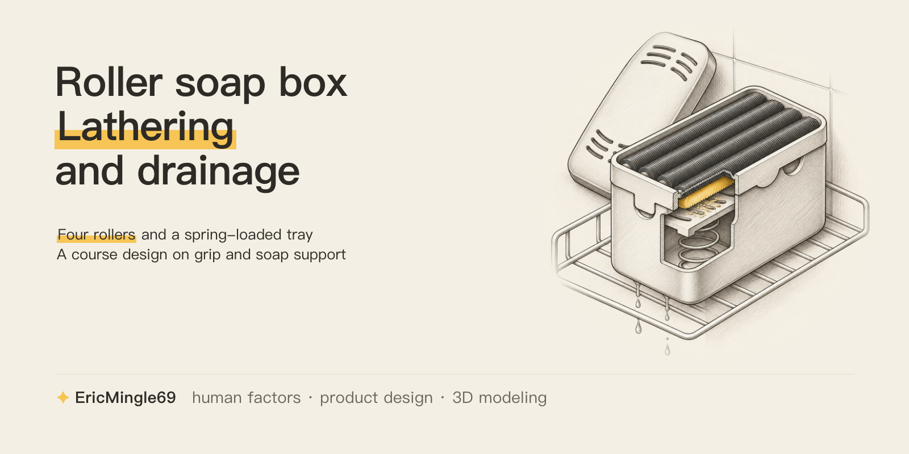
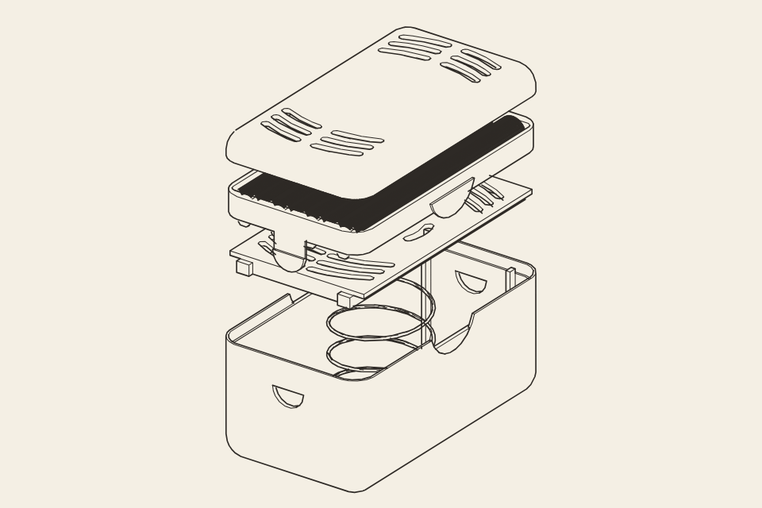

<picture>
  <source media="(prefers-color-scheme: dark)" srcset="readme-assets/cover-en-dark.png">
  
</picture>

<a href="人因工程学课程设计.pdf">Course report</a> · <a href="肥皂盒.3mf">Soap box model</a> · <a href="PERSONAL-NOTICE.md">Permissions</a> · <a href="https://github.com/Ming-Sir-69">Profile</a>

<a href="README.md">简体中文</a> · <b>English</b>

# Human factors analysis and redesign of a roller soap box

This course project examines water retention, support for soap fragments and grip in a roller soap box through structural analysis, design proposals and 3D models. The available materials comprise one course report and four 3MF model files.

## Overview

The original structure consists of a shell, soap support platform, lathering rollers and a spring. The spring presses soap on the tray against four toothed silicone rollers; rolling friction transfers wet soap to the washing surface. The report covers product analysis, problem identification, design proposals and evaluation.[[1]](#references)

## Design highlights

| Area | Structure and design decisions |
|---|---|
| Lathering and support | Four rollers work with a spring-loaded tray; the report proposes changes to roller diameter and spacing and replacement of the support spring. |
| Drainage | The model shows curved slots; the report separately proposes a wavy base and rejects a single slope that takes up too much internal space. |
| Grip | The report discusses shell shape, slip resistance and material feel. |
| Soap-fragment positioning | An adaptive fractal tray was explored, then rejected in the report because of debris blockage and maintenance cost. |

These decisions come from the report's design evaluation; they do not establish physically tested performance.[[1]](#references)

## Results

<picture>
  <source media="(prefers-color-scheme: dark)" srcset="readme-assets/model-dark.png">
  
</picture>

Exploded view of the original model. The cover is a generated illustration based on the model; the drawing above is a geometric projection of the original model. The report's proposals and the available models may represent different versions. The curved slots shown here are not the wavy base proposed in the report.

| File | Contents |
|---|---|
| [Course report](人因工程学课程设计.pdf) | Human factors analysis and redesign of a roller soap box |
| [肥皂盒.3mf](肥皂盒.3mf) | Soap box model |
| [手感改善.3mf](手感改善.3mf) | Model related to grip improvement |
| [分形结构.3mf](分形结构.3mf) | Exploratory fractal structure model |
| [分形虎钳.3mf](分形虎钳.3mf) | Fractal vise reference structure model |

## Method

Read the structural and problem analysis in the course report, then compare the models with its design evaluation. The report discusses drainage layout, grip shape, roller and spring interaction, and the fractal support proposal.[[1]](#references)

1. Download individual models from their file pages, or use Code → Download ZIP for the repository materials.
2. Open the files in software that supports 3MF and check part relationships against the report.
3. Check units, dimensions, materials and manufacturing settings before export or fabrication; filenames do not replace these checks.

## Limitations

- The original project note states that file-size limits prevented all modeling data from being uploaded, with staged uploads planned. The current directory does not guarantee complete models or source engineering files.
- Model-version relationships, the modeling environment and complete physical validation records still need documentation. Calculations, design evaluations and illustrations in the report are not measured results for drainage efficiency, grip comfort or service life.
- The fractal models document exploration, not the final accepted soap box structure. Report parameters still require independent checks before fabrication.
- There is no established common license for the original models and course PDF; downloading them does not grant adaptation, redistribution or fabrication rights.

## Acknowledgements

The course report and models are retained as the design sources. The cover illustration was generated by an image model and processed for this project; the body illustration was projected from the original model.

## References

1. [*Human factors analysis and redesign of a roller soap box*](人因工程学课程设计.pdf). Course design report in this repository: product structure, redesign and evaluation. The report's original bibliography remains in the PDF.

## Related research

The following paper provides context for a related mechanism; it is not evidence that this project adopted or validated the method.

- Barthlott, W., & Neinhuis, C. (1997). *Purity of the sacred lotus, or escape from contamination in biological surfaces*. Planta, 202, 1–8. [DOI](https://doi.org/10.1007/s004250050096). It examines surface microstructure, water repellency and particle adhesion, corresponding to the report's discussion of hydrophobic surfaces. Findings on plant surfaces do not replace material tests in soapy water.

## Repository structure

| Location | Contents |
|---|---|
| `人因工程学课程设计.pdf` | Course report |
| Four root-level `.3mf` files | Soap box, grip improvement and exploratory fractal models |
| `readme-assets/` | Bilingual light/dark covers, model drawings and documentation license |
| `PERSONAL-NOTICE.md` | Maintenance identity and permissions |

---

Documentation maintained by **✦ EricMingle69** · [Ming-Sir-69](https://github.com/Ming-Sir-69)  
Original documentation and cover artwork use the [documentation MIT license](readme-assets/PERSONAL-DOCUMENTATION-LICENSE.md); the original models, course PDF and model projections are outside that added license.
