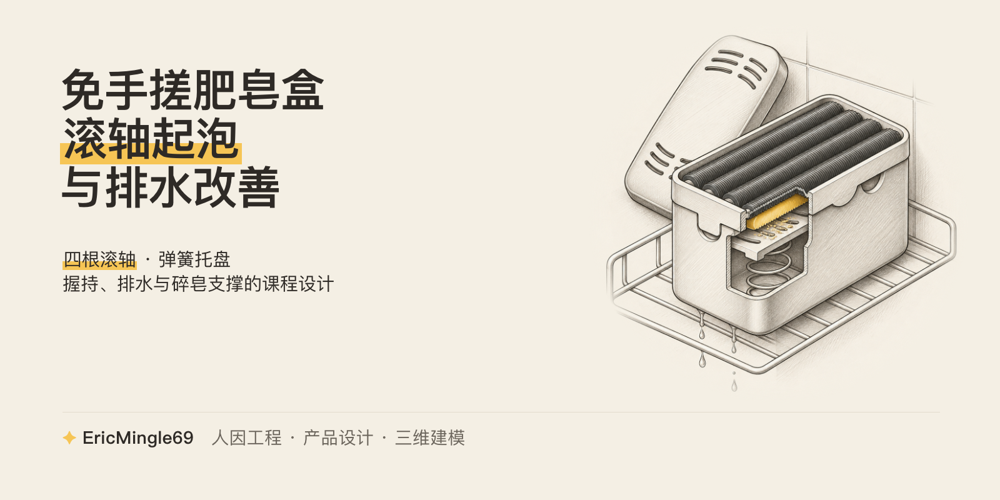
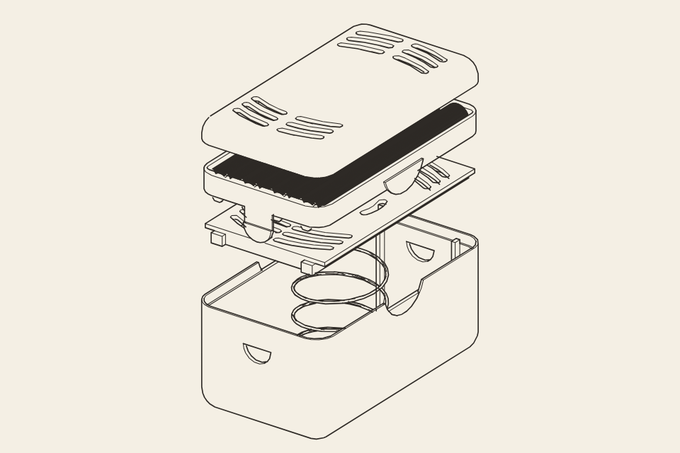

<picture>
  <source media="(prefers-color-scheme: dark)" srcset="readme-assets/cover-zh-dark.png">
  
</picture>

<a href="人因工程学课程设计.pdf">课程报告</a> · <a href="肥皂盒.3mf">肥皂盒模型</a> · <a href="PERSONAL-NOTICE.md">许可说明</a> · <a href="https://github.com/Ming-Sir-69">作者主页</a>

<b>简体中文</b> · <a href="README.en.md">English</a>

# 免手搓肥皂盒的人因分析与改善设计

本项目围绕滚轴式肥皂盒的积水、碎皂支撑和握持问题开展课程设计，整理结构分析、改善方案与三维模型。现有资料包括一份课程报告和四个 3MF 模型文件。

## 概述

原结构由外壳、肥皂支撑平台、起泡滚轴和弹簧组成：弹簧将托盘上的肥皂顶向四根硅胶齿形滚轴，使用时通过滚动摩擦将湿润的肥皂带到洗涤表面。课程报告按产品分析、问题识别、方案设计和方案评价组织。[[1]](#参考文献)

## 设计要点

| 对象 | 结构与方案取舍 |
|---|---|
| 起泡与支撑 | 四根滚轴配合弹簧托盘；报告提出调整滚轴直径、间隙，并替换支撑弹簧。 |
| 排水 | 模型展示弧形通槽；报告另提出波浪形底面，并放弃占用内部空间过大的单一斜坡。 |
| 握持 | 报告讨论外壳握持形状、防滑与材料触感的改善。 |
| 碎皂定位 | 曾探索自适应分形托盘；报告最终因碎屑堵塞和维护成本将其排除。 |

以上取舍来自课程报告的方案评价，不代表各项性能已通过实物验证。[[1]](#参考文献)

## 成果展示

<picture>
  <source media="(prefers-color-scheme: dark)" srcset="readme-assets/model-dark.png">
  
</picture>

原始模型的拆解视图。封面为基于模型生成的插画，正文线稿来自原始模型的几何投影。报告中的改善方案与现存模型可能属于不同版本；图中弧形通槽不等同于报告提出的波浪形底面。

| 文件 | 内容入口 |
|---|---|
| [课程报告](人因工程学课程设计.pdf) | 免手搓肥皂盒人因工程分析与改善设计 |
| [肥皂盒.3mf](肥皂盒.3mf) | 肥皂盒模型 |
| [手感改善.3mf](手感改善.3mf) | 握持改善相关模型 |
| [分形结构.3mf](分形结构.3mf) | 分形结构探索模型 |
| [分形虎钳.3mf](分形虎钳.3mf) | 分形虎钳参考结构模型 |

## 方法

先阅读课程报告中的结构与问题分析，再结合方案评价核对模型。报告讨论排水布局、握持形状、滚轴与弹簧配合，并比较分形支撑方案。[[1]](#参考文献)

1. 从文件页面下载所需模型，或通过 Code → Download ZIP 获取仓库资料。
2. 使用支持 3MF 的软件打开文件，对照报告核对部件关系。
3. 在导出或制造前核对单位、尺寸、材料和制造参数；文件名不能代替这些检查。

## 局限

- 原项目说明指出，受文件大小限制，完整建模数据未全部上传，计划拆分分批更新；当前目录不保证含有全部模型或源工程。
- 模型版本对应关系、建模软件环境和完整实物验证记录仍需补充。报告中的计算、方案评价和示意不等于排水效率、握持舒适度或寿命的实测结论。
- 分形模型保留的是探索过程，不是最终采纳的肥皂盒结构。报告的参数在制造前仍需独立复核。
- 原模型和课程 PDF 没有明确的统一许可；下载不代表已取得改作、再分发或制造授权。

## 致谢

本仓库保留课程报告与模型资料作为设计来源。封面插画由图像生成模型生成，经本项目处理；正文线稿由原始模型投影生成。

## 参考文献

1. [《免手搓肥皂盒人因工程分析与改善设计》](人因工程学课程设计.pdf). 本仓库课程设计报告：产品结构、改善设计与方案评价。报告原参考文献保留在 PDF 中。

## 相关研究

以下文献用于说明相关机制，不作为本项目已经采用或验证该方法的依据。

- Barthlott, W., & Neinhuis, C.（1997）. *Purity of the sacred lotus, or escape from contamination in biological surfaces*. Planta, 202, 1–8. [DOI](https://doi.org/10.1007/s004250050096)。讨论表面微结构、拒水性与颗粒附着的关系，对应报告中的疏水表面讨论；植物表面结论不能直接替代肥皂水环境中的材料测试。

## 仓库结构

| 位置 | 内容 |
|---|---|
| `人因工程学课程设计.pdf` | 课程报告 |
| 根目录四个 `.3mf` 文件 | 肥皂盒、握持改善与分形探索模型 |
| `readme-assets/` | 中英亮暗封面、模型线稿和文档许可 |
| `PERSONAL-NOTICE.md` | 维护标识与权限范围 |

---

文档维护：**✦ EricMingle69** · [Ming-Sir-69](https://github.com/Ming-Sir-69)  
原创文档与封面视觉适用[文档 MIT 许可](readme-assets/PERSONAL-DOCUMENTATION-LICENSE.md)；原模型、课程 PDF 与模型投影不在该新增许可范围内。
